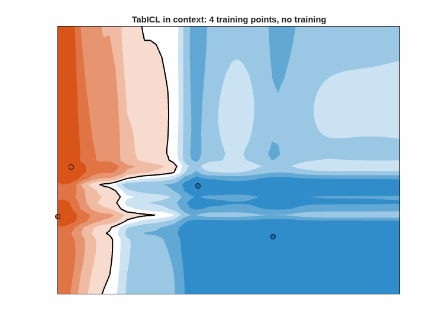
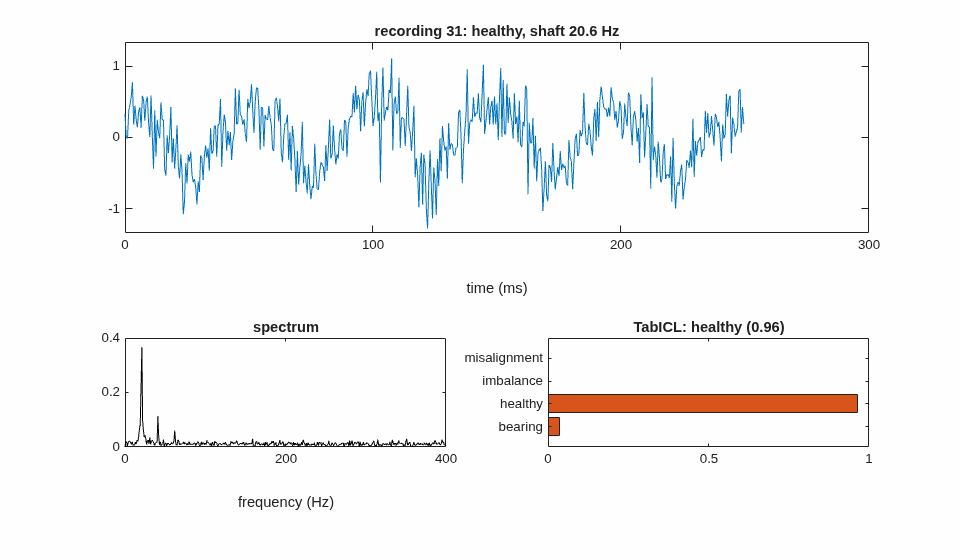
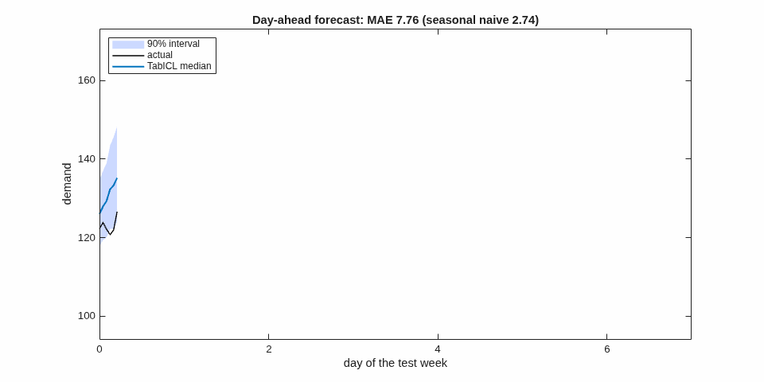

# maticl: TabICL in pure MATLAB

[](https://github.com/yanndebray/maticl/actions/workflows/tests.yml)
[](https://matlab.mathworks.com/open/github/v1?repo=yanndebray/maticl&file=examples/vibration_faults.m)

A port of [TabICL](https://github.com/soda-inria/tabicl) v2, the tabular
in-context-learning foundation model from Inria's Soda team, to plain MATLAB
with no toolboxes. Give it a labelled training table and it classifies new
rows, or predicts a continuous target, in a single forward pass, with no
training or tuning. It reproduces the Python `TabICLClassifier` and
`TabICLRegressor`, including the preprocessing and ensembling, and is tested
on three runtimes:

* [MATLAB](https://www.mathworks.com/products/matlab.html), tested manually in MATLAB Online
* [Nelson](https://nelson-lang.github.io/nelson-website/) 2.0
* [RunMat](https://runmat.com) 0.6.2

```matlab
addpath src
M   = tabicl_load();                           % pretrained weights, once
clf = tabicl_fit(Xtrain, ytrain, 'Model', M);  % "fit" = store context
[yhat, proba] = tabicl_predict(clf, Xtest);

R   = tabicl_load('regressor');                % regression checkpoint
reg = tabicl_fit_regressor(Xtrain, ytrain, 'Model', R);
[yhat, out] = tabicl_predict_regressor(reg, Xtest);   % mean, median, quantiles
```

<p align="center"></p>

## Results

Compared with the reference Python package (`tabicl` 2.2.0, same checkpoint,
same ensemble):

| test | Nelson 2.0 | RunMat 0.6.2 |
|---|---|---|
| raw forward pass, max logit error | 1.9e-5 | 1.9e-5 |
| iris: max probability error / accuracy (Python 1.000) | 2.1e-6 / 1.000 | 2.1e-6 / 1.000 |
| wine: max probability error / accuracy (Python 1.000) | 3.8e-7 / 1.000 | 3.8e-7 / 1.000 |
| breast cancer: max probability error / accuracy (Python 0.9532) | 3.8e-6 / 0.9532 | 3.8e-6 / 0.9532 |
| 26 classes, raw forward pass: max probability error | 7.5e-6 | 7.5e-6 |
| 15 classes (synthetic): max probability error / accuracy (Python 0.8889) | 3.5e-6 / 0.8889 | 3.4e-6 / 0.8889 |
| diabetes regression: max error of mean / median / quantiles, in units of std(y) | 2.9e-6 / 3.7e-6 / 2.0e-5 | 2.9e-6 / 3.7e-6 / 2.0e-5 |
| mixed-type table: max probability error / accuracy (Python 0.7333) | 3.6e-6 / 0.7333 | 3.6e-6 / 0.7333 |

The remaining differences are float32 rounding (PyTorch computes in float32,
maticl in double). Predicted labels agree 100% on all datasets. The two
many-class rows use more classes than the checkpoint's 10, which goes through
the many-class strategy (see below). The largest regression error is in the
extrapolated tail (level 0.9995); inside the predicted quantiles it is below
4e-6. The full suite takes about a minute on Nelson; on RunMat the tests take
about 21 min (classification) + 25 min (many-class) + 7.5 min (regression) + 1 min (table),
measured separately.

## Setup

Nothing to install. On first use `tabicl_load()` downloads the official
checkpoint from Hugging Face
([jingang/TabICL](https://huggingface.co/jingang/TabICL),
`tabicl-classifier-v2-20260212.ckpt`, 110 MB) into `weights/` and reads it
directly. A PyTorch `.ckpt` is a zip of raw float32 tensor files, and the
committed index `assets/tabicl-classifier-v2.idx` says which file holds which
tensor. This works in MATLAB (including MATLAB Online), Nelson and RunMat.
`tabicl_load('regressor')` does the same with
`tabicl-regressor-v2-20260212.ckpt` (114 MB) and
`assets/tabicl-regressor-v2.idx`.

Optionally, with Python you can export a single flat weight file, which loads
slightly faster:

```sh
uv venv .venv-ref -p 3.12
uv pip install --python .venv-ref/bin/python tabicl
.venv-ref/bin/python tools/export_weights.py   # -> weights/tabicl-classifier-v2.{idx,bin}
.venv-ref/bin/python tools/export_weights.py --model regressor
```

`tabicl_load` uses `weights/tabicl-<classifier|regressor>-v2.bin` if it exists.

## Usage

```matlab
addpath src
M = tabicl_load();                 % or tabicl_load('path/to/prefix')

clf = tabicl_fit(X, y, 'Model', M, 'NumEstimators', 8);
proba = tabicl_predict_proba(clf, Xtest);   % columns follow clf.classes
yhat  = tabicl_predict(clf, Xtest);
```

* `X` is a numeric matrix; `NaN` values are mean-imputed.
* `X` can also be a `table`. Numeric variables pass through; `categorical`,
  `string`, cellstr and `logical` variables are ordinal-encoded as in
  Python's `TransformToNumerical`: sorted distinct values become 0, 1, …,
  and missing values (`<undefined>`, `<missing>`, `''`) and categories unseen
  in training become -1. `y` may then be a variable name:
  `tabicl_fit(T, 'label')`. Predict with a table holding the same variable
  names, in any order. The encoder is stored in `clf.encoder`.
* `y` can be numeric, a string array or a cellstr, with any number of
  classes. Beyond 10 (the checkpoint's limit), maticl uses the same
  many-class strategy as Python: mixed-radix label ensembling in the column
  embedding and hierarchical classification in the ICL stage. Each ensemble
  member then costs one column-embedding pass per label digit and one ICL
  pass per tree node (2 and 4 for 26 classes).
* `examples/` has worked examples, see [Examples](#examples).

`tabicl_fit` options (defaults follow `TabICLClassifier`):

| option | default | meaning |
|---|---|---|
| `'Model'` | loaded on demand | struct from `tabicl_load`; pass it to avoid reloading |
| `'NumEstimators'` | 8 | ensemble size |
| `'NormMethods'` | `{'none', 'power'}` | normalisations cycled through the ensemble |
| `'FeatShuffle'` | `'latin'` | feature permutations: `latin`, `shift`, `random`, `none` |
| `'ClassShuffle'` | `'shift'` | class permutations, same choices |
| `'OutlierThreshold'` | 4 | in standard deviations |
| `'SoftmaxTemperature'` | 0.9 | |
| `'AverageLogits'` | true | average logits (else probabilities) over members |
| `'Seed'` | 42 | RNG seed for the permutations (`[]` keeps the current state) |
| `'Ensemble'` | | explicit members to replay, see `tests/test_classifier.m` |

### Regression

```matlab
R = tabicl_load('regressor');
reg = tabicl_fit_regressor(X, y, 'Model', R, 'NumEstimators', 8);
yhat = tabicl_predict_regressor(reg, Xtest);                  % predicted mean
[yhat, out] = tabicl_predict_regressor(reg, Xtest, 'Alphas', [0.05 0.5 0.95]);
% out.mean, out.median, out.quantiles (one column per level), out.alphas
```

`y` is a numeric vector; it is standardised internally and predictions are
mapped back. `tabicl_fit_regressor` takes the options of `TabICLRegressor`:
`'Model'`, `'NumEstimators'`, `'NormMethods'`, `'FeatShuffle'`,
`'OutlierThreshold'`, `'Seed'` and `'Ensemble'`, with the same defaults as
`tabicl_fit` (there is no class shuffling). The model predicts 999
quantiles per row; the median and other quantiles interpolate between them,
with exponential tails beyond levels 0.001 and 0.999, as
`QuantileDistribution` does.

### Lower level

`[logits, proba] = tabicl_forward(M, Xtr, ytr, Xte)` runs the model on an
already-preprocessed table. It returns raw logits, plus `proba` (the
hierarchical class probabilities) when there are more than 10 classes, or raw
quantiles with the regressor. The three stages are `tabicl_col_embed`,
`tabicl_row_interact` and `tabicl_icl`.

## Examples

Each script simulates its data, so it runs offline after the first weight
download. They run in MATLAB and Nelson (plots are skipped in `nelson-cli`).

| script | task | result |
|---|---|---|
| [`examples/vibration_faults.m`](examples/vibration_faults.m) | **Signal processing:** diagnose machine faults (imbalance, misalignment, bearing defect) from vibration recordings, via statistical, order and envelope-spectrum features computed with `fft` | 0.950 accuracy on 160 test recordings, 4 classes |
| [`examples/load_forecasting.m`](examples/load_forecasting.m) | **Time series:** day-ahead hourly electricity-demand forecast with the regressor on calendar and lag features, with 90% prediction intervals | MAE 5.0 vs 9.1 for the seasonal-naive forecast |
| [`examples/two_moons.m`](examples/two_moons.m) | minimal classification | 0.990 accuracy |

<p align="center">


</p>

The animations are rendered with MATLAB by `tools/make_gifs.m` (run on
demand by the `gifs` workflow).

The forecasting example turns forecasting into tabular regression, using
only lags of at least 24 hours so that a whole day is predicted at once. The
Python package also has a dedicated time-series forecaster, which is not
ported. The intervals are conservative: they cover 98.8% of the test hours.

## Running the tests

The fixtures in `tests/fixtures` (inputs and PyTorch outputs) are committed,
so the tests need neither Python nor a manual weight export (they load both
checkpoints):

```sh
nelson-cli -f tests/run_tests.m
cd "$(mktemp -d)" && runmat /path/to/maticl/tests/run_tests.m
```

```matlab
run('tests/run_tests.m')          % MATLAB
```

* RunMat compiles every `.m` file in the working directory, so start it from
  a directory without unrelated `.m` files.
* CI (`.github/workflows/tests.yml`) runs the suite on MATLAB for every push
  and pull request that changes a `.m` file. Nelson and RunMat (about 20
  minutes) run only on manual dispatch. The Nelson job is informational:
  the only Linux build is 1.17, which fails (no `strtok`, out of memory).
* `tools/make_reference.py [clf|reg]` regenerates the fixtures from the
  Python package (the mixed-type case also needs `pandas`).
* `tools/export_weights.py [--model regressor]` also regenerates the index in
  `assets/`.

## Documentation

* [docs/architecture.md](docs/architecture.md): the model and the pipeline,
  stage by stage, mapped to the PyTorch sources.
* [docs/portability.md](docs/portability.md): the MATLAB subset that runs on
  all three runtimes, the RunMat 0.6.2 workarounds, and performance notes.

## Layout

```
src/        the implementation (25 functions)
tests/      run_tests.m, test_forward.m, test_classifier.m, test_regressor.m,
            test_table.m, fixtures/
tools/      export_weights.py, make_reference.py (PyTorch side)
assets/     tensor indexes of the Hugging Face checkpoints
docs/       architecture and portability notes
examples/   vibration fault diagnosis, load forecasting, two moons
```

## Limitations

* Regression returns the mean, median and quantiles only (no variance,
  CRPS or log-density).
* Table input has been tested on Nelson and RunMat; MATLAB is covered by CI.
* CPU, double precision. Nelson takes about 2 s per ensemble member on a
  400-row, 30-feature table. RunMat is currently about 30× slower because
  of its matrix-multiply speed and per-statement overhead (see
  docs/portability.md).

## License and credits

BSD 3-Clause, see [LICENSE](LICENSE). maticl is a derivative of
[TabICL](https://github.com/soda-inria/tabicl), © 2025 Soda team @ Inria.
If you use it, please cite the TabICL papers:

* Qu, Holzmüller, Varoquaux, Le Morvan, *TabICL: A Tabular Foundation Model
  for In-Context Learning on Large Data*, ICML 2025.
* the TabICLv2 paper for the v2 checkpoint used here (see the
  [TabICL README](https://github.com/soda-inria/tabicl#citation)).
